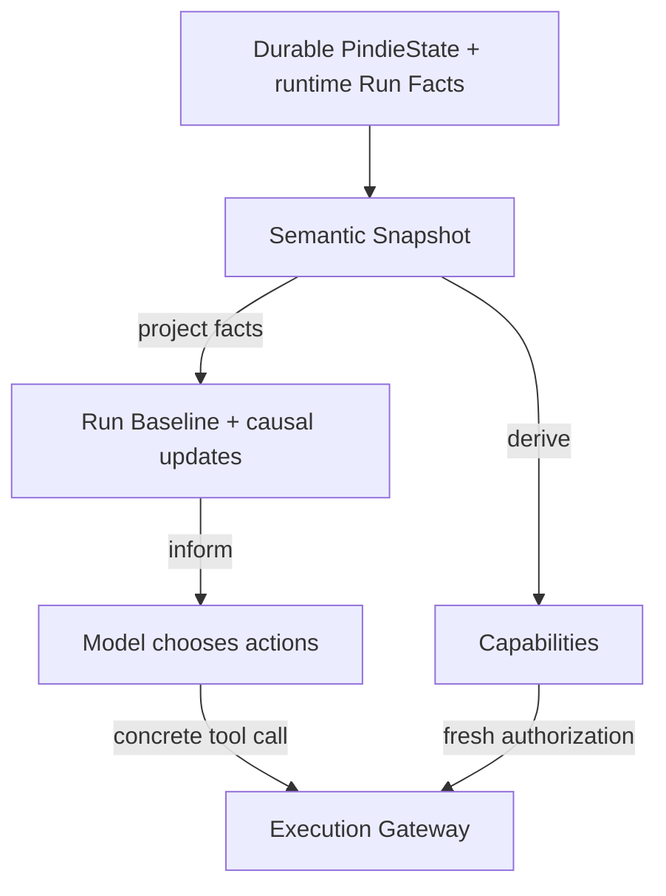
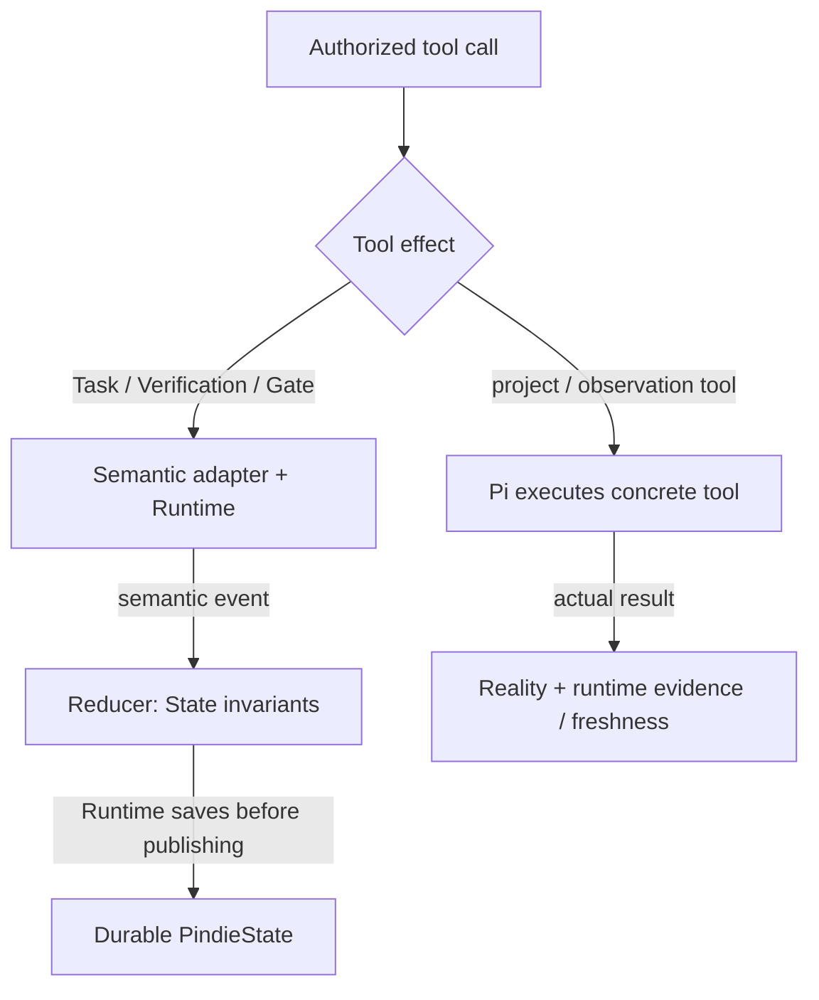

# Pindie

> A personal AI agent for indie development, built on [Pi](https://pi.dev).

Pindie carries one durable development Task from intent to verified completion, with explicit success criteria and human approval boundaries. Pindie Host owns the process and active Session lifecycle; Pi supplies model invocation, concrete tools, native Skills, compaction and the low-level Agent Loop. Pindie adds semantic State, execution authorization and factual verification provenance—not a second agent harness.

## Architecture

Two paths share the same semantic authority:





Pi owns the active tool set; Pindie does not hide tools as Task state changes. **Visibility is not authorization:** the Gateway rechecks consequential calls against current authority. Only semantic events go through the Reducer; ordinary file/shell tools do not. Actual results supply evidence, while the model judges what that evidence proves. See [Architecture](docs/architecture.md) for lifecycle and composition details.

| Owner | Responsibility |
| --- | --- |
| Human | Goals, taste, consequential judgment and approval |
| Model | Interpretation, planning, semantic choices and verification coverage |
| Pindie Host | Process and active Pi runtime lifecycle/replacement |
| Pindie semantic layer | Durable current-work State, capabilities, Gateway and evidence freshness |
| Pi | Session implementation, model/tool execution, Skills, retries, compaction and native interactive UI |

## Main features

- One current Task, explicit criteria, blockers/questions, verification and Human Gates.
- Verification grounded in actual tool results; project mutation invalidates stale checks.
- Bounded continuation and safe Session rollover for long Tasks, without a Task queue or second Agent Loop.
- Native Pi interactive shell, runtime activity/time/cost reporting and `/efficiency`.
- Private loopback MCP Control: select/create a workspace project, send intent, manage Sessions and observe work; `control:watch` and native `/watch` are read-only observers.
- Default-on, lazy Browser Reality tools with a Host-owned isolated Chrome/Chromium profile.
- Codex subscription quota auto-resume (`/quota-resume`, default ON); opt-in same-Session paid backup (`/quota-fallback`, default OFF), with stable `provider/modelId` choices, Follow source Thinking and explicit draft Apply/Save ([settings](docs/settings-phase2-quota-fallback.md)).
- `/discord-remote` saves global startup preference `discordRemote` (default ON for compatibility). For headless Control, set `"discordRemote": false` in `~/.pindie/global/preferences.json`, preserving other fields, then apply on the next authorized Host restart/recreation. OFF runs no Discord work, leaves existing channels/messages/Sessions untouched, and does not disable MCP/Watch/Task. See [activation details](docs/remote-companion.md#3-configuration-and-security).
- Optional Discord Remote Companion and Notion Work Memory; bundled development and Git Skills use Pi's native Skill runtime.

## Start and use

Requires **Node.js 22.19+** and **pnpm 11.22.0** (pinned in `package.json`). Run from this checkout; Pindie imports its project-local **Pi 1.4.0** SDK, not a global Pi installation.

```bash
pnpm install --frozen-lockfile
pnpm pindie
```

Configure a provider through Pi's native `/login` or provider credentials, then describe the work in ordinary language. The model uses Pindie's Task/verification/Gate tools when appropriate; you do not need to issue a Task command manually. Native Pi owns model/thinking controls. Pindie defaults to fullscreen unless an explicit Host option or Pi `tuiMode` setting overrides it; set `"tuiMode": "regular"` in Pi settings to retain terminal-owned scrollback.

### Private MCP Control and observers

Start a separate workspace service **instead of another interactive owner of the same Session**:

```bash
PINDIE_WORKSPACE_ROOT=/path/to/workspace pnpm control:mcp
```

The workspace must exist. Startup selects no project: list direct-child projects and explicitly open or create one through Control. The service offers 13 `pindie_*` tools at `http://127.0.0.1:8765/mcp`; `PINDIE_CONTROL_PORT` overrides the port. It binds loopback only and validates Host/Origin headers. Point OpenAI Secure MCP Tunnel at this URL with `--mcp-server-url`, not `--mcp-command`. Project switching does not require restarting the endpoint or tunnel.

To observe that already-running service:

```bash
pnpm control:watch
```

This monitor has no composer or runtime controls. Native `/watch` opens a read-only overlay observing the same Control service, **not** the local interactive Session. Respond to observed Human Gates through Control. See [Control workspace/usage](docs/pindie-control-v0.2.md) and [Watch interactions and limits](docs/watch-mode-poc.md).

### Optional integrations

| Integration | Configuration | Details |
| --- | --- | --- |
| Discord | Global `discordRemote` (default ON), plus `PINDIE_DISCORD_TOKEN`, `PINDIE_DISCORD_USER_ID`, `PINDIE_DISCORD_GUILD_ID` | [Remote security, routing and input](docs/remote-companion.md#3-configuration-and-security) |
| Notion Work Memory | `PINDIE_NOTION_TOKEN`, `PINDIE_WORK_MEMORY_DATA_SOURCE_ID` | [Capture semantics and permissions](docs/architecture.md#14-work-memory-v01--approved-architecture) |

Each integration requires its complete configuration. Keep credentials out of Git. Neither integration owns semantic State or creates another Session.

### Browser Reality

Browser tools register at startup without launching Chrome or the DevTools bridge. The first browser action lazily starts a dedicated headless browser/profile, reused across Host Sessions. On native Linux, install Chrome/Chromium (`google-chrome-stable`, `google-chrome`, `chromium`, or `chromium-browser` on `PATH`). On WSL, mirrored networking and Windows Chrome at `C:\Program Files\Google\Chrome\Application\chrome.exe` are required.

```bash
# Visible dedicated Chrome for debugging:
PINDIE_BROWSER_HEADLESS=false pnpm pindie
# Disable Browser Reality:
PINDIE_BROWSER_ENABLED=false pnpm pindie
```

Advanced overrides: `PINDIE_BROWSER_EXECUTABLE`, `PINDIE_BROWSER_URL` (HTTP loopback with explicit port; refuses an already-running endpoint), and `PINDIE_BROWSER_PROFILE_DIR` (developer-managed, never automatically deleted).

`browser_status` reads resource phase without startup; `browser_release` discards owned browser state when no browser calls are in flight. A subsequent action starts fresh. Automatic idle release requires 15 minutes of inactivity and known settled Session/UI authority with no queued work, Human Gate or quota wait.

Normal shutdown awaits owned cleanup; crash/SIGKILL cannot guarantee it. Unconfirmed termination retains the profile and blocks replacement. No startup janitor adopts/kills old browsers or deletes old profiles. See [Browser lifecycle and platform safety](docs/architecture.md#browser-reality-v02) before any manual cleanup.

## Documentation

| Read for | Current contract |
| --- | --- |
| Ownership, semantic derivation, composition, Browser and Work Memory | [Architecture](docs/architecture.md) |
| Task, verification, authorization and continuation behavior | [Behavior](docs/behavior.md) |
| Workspace selection, Sessions, MCP tools and observers | [Control v0.2](docs/pindie-control-v0.2.md), with [v0.1 runtime safety](docs/pindie-control-v0.1.md) |
| Context lifetime and safe Session rollover | [Long Task Runtime](docs/long-task-runtime.md) |
| Quota recovery and paid-backup authorization | [Quota Fallback](docs/quota-fallback-v0.1.md) |
| Discord projection/control | [Remote Companion](docs/remote-companion.md) |
| Native read-only Watch overlay | [Watch contract](docs/watch-mode-poc.md) (legacy filename) |
| Pinned SDK compatibility and historical rollout boundaries | [Pi 1.4.0 audit](docs/pi-1.4.0-compatibility.md) |
| Contributor procedure | [Agent instructions](AGENTS.md), [Development execution](skills/development-execution/SKILL.md), [Git workflow](skills/git-workflow/SKILL.md) |

[Pi 1.3.0 audit](docs/pi-1.3.0-compatibility.md) is historical patch-retirement/rollback evidence, not the current runtime guide. Versioned Control and quota contracts remain authoritative within their stated boundaries; completed implementation slices are not pending feature plans.

## Development checks

```bash
pnpm run typecheck
pnpm test
pnpm run check
```

`check` runs typechecking and the full test suite. [CI](.github/workflows/ci.yml) runs the same check on pull requests. For bounded subprocess diagnostics, `pnpm smoke -- <label> [--timeout-ms <ms>] -- <command> [args...]` uses the owned scratch/lifetime wrapper in [`scripts/pi-smoke.ts`](scripts/pi-smoke.ts); it is not a production acceptance test.
